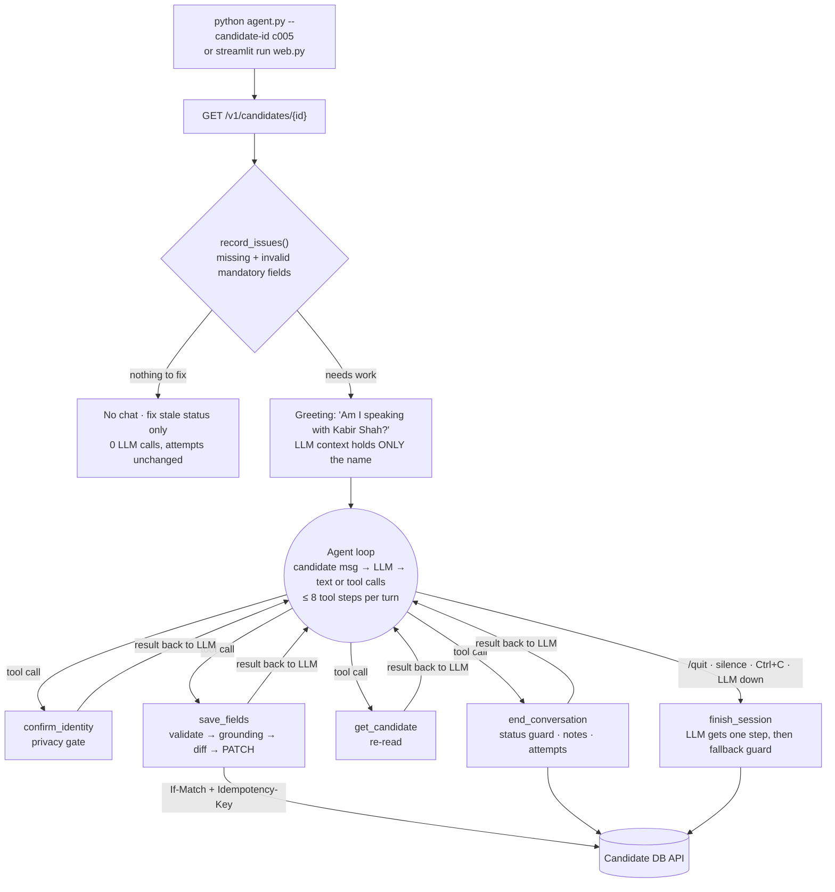

# Architecture

**One candidate in → fetch → find what's missing *or invalid* → chat → validate → write safely →
record the outcome.** The LLM decides; Python enforces.

## 1. The loop and the tools

A plain loop with native tool calling (OpenAI-compatible SDK, Gemini). No framework. Each candidate
message goes to the LLM. The LLM either replies or calls tools, Python runs them and returns the
real result, and the loop continues until the LLM replies. The **candidate ID is fixed by the CLI**,
so the LLM can never touch another record.

| Tool | The LLM decides | Python enforces |
|---|---|---|
| `confirm_identity` | whether the reply confirms identity | only after a real reply; record values released only after confirmation; wrong person → nothing revealed, `needs_human` |
| `save_fields` | what it extracted, when to save | schema validation → **grounding check** (value must be stated by the candidate or confirmed after a read-back) → diff (only changed values) → protect existing valid values → versioned PATCH |
| `get_candidate` | when to re-read | blocked before identity |
| `end_conversation` | outcome + summary | a false `completed` is refused in code; wrong person → `needs_human`; no reply → `no_answer`; attempts +1 once; offset-aware timestamp; note appended |

## 2. Writing safely

- **Diff-only PATCH**: only changed, validated, writable fields. Never `phone`/`id`/`version`.
- **`If-Match: "<version>"`** on every PATCH. **409** → re-read, keep the other writer's values,
  retry only our still-safe fields with a **new** `Idempotency-Key`. A second 409 is reported, not looped.
- **Idempotency-Key** reused only for network/5xx retries of the identical request, so a retry is never applied twice.
- **Notes** are appended (dated, ≤4000 chars, newest kept), never overwritten.
- **Fallback guard**: any exit (`/quit`, silence, Ctrl+C, LLM outage, turn limit) still writes a correct status.

## 3. Edge cases

| Situation | Behaviour |
|---|---|
| Silence | one LLM-written nudge, then close: `no_answer` (or `in_progress` if they gave data) |
| "Later, tomorrow 7 pm" | `in_progress`, remaining fields + time in notes |
| Refuses a mandatory field | explain once, respect it → `refused` + field in notes |
| Invalid answer (CGPA 85%) | rejected with a reason; the agent re-asks, never converts |
| Ambiguous ("Bangalore", "June") | read back the exact value; saved only after confirmation |
| Existing value looks wrong | shown to the candidate, replaced only with their correction |
| Wrong person / dispute / upset | `needs_human`, no data written |
| Earlier chat in notes | acknowledged; continue where it stopped (notes are untrusted data) |

## 4. State

- **Database**: source of truth for field values, `collection_status`, `attempt_count`, `last_contacted_at` and `notes` (memory across chats).
- **Session** (in memory, one run): latest record and version, identity state, chat log for grounding, fields saved, finalized flag.
- **`runs/`**: a JSONL trace (API requests and responses, LLM calls, tool args and results) plus a transcript per run.

## 5. Files

| File | Role |
|---|---|
| `agent.py` | CLI + shared conversation core (`start_session`, `run_turn`, `run_event`, `finish_session`), LLM fallback chain, run logs |
| `web.py` | Streamlit UI over the same core |
| `tools.py` | the 4 tools, identity gate, grounding, diff, 409 handling, status guard |
| `validation.py` | schema rules, issue detection, `is_grounded` |
| `api.py` | HTTP client: If-Match, Idempotency-Key, retries |
| `prompts.py` | goals and rules for the LLM (no question script) |
| `scripts/show.py`, `scripts/reset.py` | demo helpers: inspect a record; reset the workspace |
| `tests/`, `eval/` | mocked tests, live API tests (`pytest -m live`), scenario evaluator |

## 6. Testing

- **Mocked** (`pytest`): validators, identity gate, grounding, diff, 409, idempotency, status guard, notes.
- **Live API** (`pytest -m live`): diff-only write, real 409, same-field conflict, idempotency, no-op.
- **Live chats**: `runs/` (some candidate replies were piped, the web-UI runs were typed).
- **Scenario evaluator** (`python -m eval.run_eval`): scores DB state after scripted personas.
  Only some scenarios have been run live, because of LLM quota.
